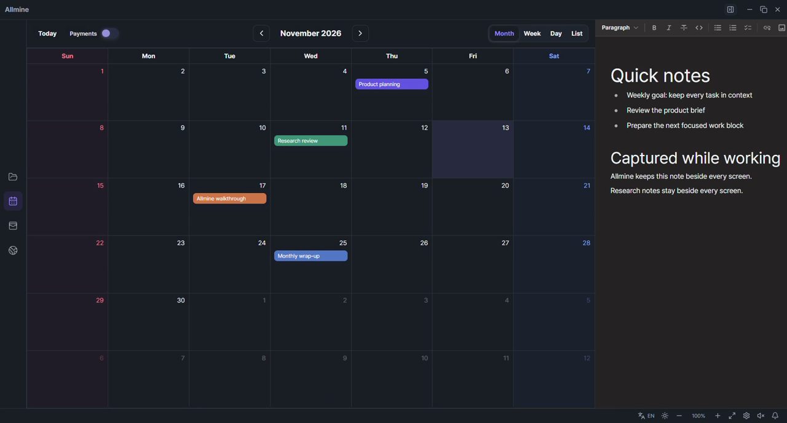

# Allmine Desktop

🚀 다양한 작업을 한곳에서 편하게 ✨

**🧩 All in one, Allmine! 💜**

[English](README.md)

## 데모

## 주요 기능

- **캘린더** — 월·주·일·목록 보기로 일정을 계획합니다.
- **워크스페이스** — 로컬 폴더를 탐색하고 Markdown을 편집하며 파일을 미리 봅니다.
- **메모** — 떠오른 생각을 빠르게 기록하고 자동으로 저장합니다.
- **가계부** — 생활 지출과 정기 지출을 한곳에서 확인합니다.
- **내장 브라우저** — 자주 쓰는 페이지와 작업 흐름을 앱 안에서 이어갑니다.

## 다운로드

최신 버전은 **[GitHub Releases](https://github.com/leeju0/Allmine-Desktop/releases/latest)**에서 받을 수 있습니다.

- Windows 10·11 64비트: `Allmine-<version>-Setup.exe`
- macOS Intel·Apple Silicon: `Allmine-<version>-universal.dmg`

## 로컬 중심

일정, 메모, 설정, 브라우저 데이터와 워크스페이스 정보는 기본적으로 사용자의 기기에 저장됩니다. Allmine은 사용자의 문서나 메모를 별도의 Allmine 서버로 자동 업로드하지 않습니다.

## 링크

[최신 버전](https://github.com/leeju0/Allmine-Desktop/releases/latest) · [릴리스 기록](RELEASES.md) · [문제 제보](https://github.com/leeju0/Allmine-Desktop/issues)
