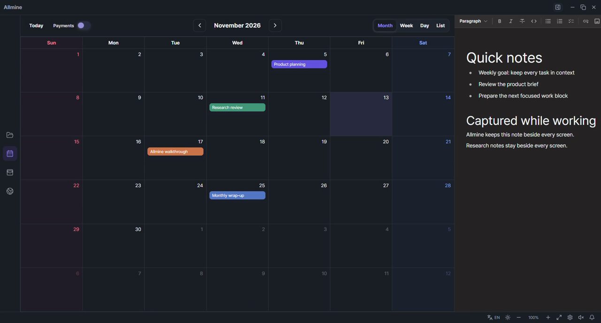

# Allmine Desktop

🚀 Bring your work together in one place, with ease ✨

**🧩 All in one, Allmine! 💜**

[한국어](README.ko.md)

## Demo

## Highlights

- **Calendar** — Plan with month, week, day, and list views.
- **Workspace** — Browse local folders, edit Markdown, and preview files.
- **Notes** — Capture ideas quickly with automatic saving.
- **Finance** — Track everyday and recurring expenses in one place.
- **Built-in browser** — Keep useful pages and work sessions close at hand.

## Download

Get the latest version from **[GitHub Releases](https://github.com/leeju0/Allmine-Desktop/releases/latest)**.

- Windows 10 or 11 (64-bit): `Allmine-<version>-Setup.exe`
- macOS (Intel and Apple Silicon): `Allmine-<version>-universal.dmg`

## Local-first

Your calendar, notes, settings, browser data, and workspace information stay on your device by default. Allmine does not automatically upload your documents or notes to an Allmine server.

## Links

[Latest release](https://github.com/leeju0/Allmine-Desktop/releases/latest) · [Release history](RELEASES.md) · [Report an issue](https://github.com/leeju0/Allmine-Desktop/issues)
